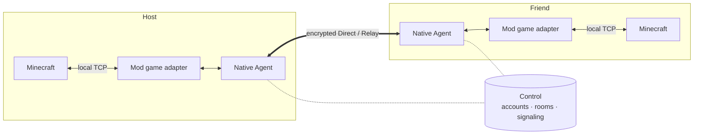

<div align="center">


# P2WLAN Minecraft

**Open a room in-game and play with friends as if you shared a LAN.**


[](LICENSE)

[简体中文](README.md) · English

[Get the Mod](#get-the-mod) · [User guide (Chinese)](minecraft-mod/docs/quickstart.md) · [Technical reference](minecraft-mod/README.md) · [Contributing](CONTRIBUTING.md)

</div>

---

P2WLAN Minecraft is a **Minecraft Java multiplayer Mod**. Sign in and create a room in-game; once friends join with the room code, the host's shared world appears in the vanilla Multiplayer list, ready to join with a double-click.

This repository focuses on the Minecraft Mod. It bundles a native Agent built on the encrypted networking core of [P2WLAN](https://github.com/yhan-sun/p2wlan). Players connect peer-to-peer whenever possible and fall back to an encrypted relay when hole punching fails. Everything runs in user space: no separate VPN client, no changes to system network interfaces or routes.

## Features

- **All in-game** — A pixel LAN icon in the title, Multiplayer and pause menus; `/p2wlan-client` opens the same panel.
- **Room-based play** — Create a room; friends join with an 8-digit room code and password.
- **Vanilla server browser** — Shared worlds appear in the Multiplayer list. Select, double-click or press Join Server; your saved servers stay untouched.
- **Integrated and dedicated servers** — Share or unshare a singleplayer world with one click; configure dedicated servers through the Minecraft console and restore the saved room/sharing on restart.
- **Direct first, Relay fallback** — The native core handles encrypted sessions, NAT traversal and Direct/Relay switching.
- **Live network stats** — RTT, Direct/Relay path, virtual IP, jitter, MTU and traffic at a glance, plus an optional in-game HUD and latency statistics.
- **Vanilla join flow** — Preserves player login, configuration and resource-pack consent. Shared integrated worlds accept offline game names; dedicated servers follow `online-mode`. P2WLAN accounts are separate from Minecraft accounts.
- **Dedicated console controls** — Initialize, sign in, create/join a room and share after server startup. Manual disconnect/unshare choices are saved for the next startup.

## Get the Mod

In this repository, open **Actions → Minecraft Mod Build → a successful run for the desired source commit → Artifacts** and download `p2wlan-minecraft-mod-<source SHA>`. The [workflow configuration](.github/workflows/minecraft-mod.yml) produces these files after a successful build and retains them for 14 days:

| File | Purpose |
| --- | --- |
| `p2wlan-universal.jar` | The same Mod for clients, integrated-world hosts and dedicated servers; place it in the instance's `mods/` |
| `p2wlan-hmcl-<minecraft>-<loader>-windows-x86_64.zip` | One Windows x64 HMCL modpack for each of the ten exact profiles |
| `BUILD-METADATA.json`, `SHA256SUMS` | Source commit, bundled native targets, artifact inventory and SHA-256 hashes |

Extract the downloaded Actions artifact first, then use its JAR or an inner HMCL ZIP. Import the inner profile ZIP through HMCL's modpack installer; Fabric packs already include the matching full Fabric API. Minecraft, the loader, Java and game accounts are prepared through the launcher's normal flow.

The automated JAR contains native resources for **Windows x64, Linux x64 and macOS Apple Silicon**. Intel Mac and Linux ARM64 resources can be built with the source tools. Use 64-bit Java matching the native target's architecture; Windows game instances and private directories require local NTFS.

Packages are delivered as Actions artifacts; the workflow does not create a Release. See the [build and packaging reference](minecraft-mod/docs/reference/building.md#github-actions-build) for the full artifact contract and verification.

## Game and loader versions

Players, integrated-world hosts and dedicated servers use the same **`p2wlan-universal.jar`** for these ten exact profiles. Friends use the same Minecraft version. Manual Fabric Mod installations also need the matching full Fabric API installation JAR from the table.

| Minecraft Java Edition | Fabric Loader / API | Forge | NeoForge | Game Java |
| --- | --- | --- | --- | --- |
| 1.16.5 | 0.16.14 / 0.42.0+1.16 | 36.2.42 | — | 17 |
| 1.18.2 | 0.16.14 / 0.77.0+1.18.2 | 40.3.12 | — | 17 |
| 1.20.1 | 0.16.14 / 0.92.12+1.20.1 | 47.3.2 | 47.1.106 | 17 |
| 1.21.1 | 0.16.14 / 0.116.7+1.21.1 | 52.1.16 | 21.1.256 | 21 |

Use 64-bit Java. Forge 1.16.5 with Java 17 requires `-Dnashorn.args=--anonymous-classes=false`. The profile source is [`minecraft_profiles.py`](minecraft-mod/tools/minecraft_profiles.py).

The table lists the complete pins for four game versions and ten loader profiles. Other game patch versions or loader combinations are outside the current matrix. Everyone needs the same trusted P2WLAN Control service, which is [self-hostable](docs/guides/self-hosting.md); Relay fallback also requires a configured Relay.

## Quick start

```text
Sign in  →  Create / join room  →  Connect room  →  Host shares world  →  Friends join via Multiplayer
```

1. **Install** — [Get the Mod](#get-the-mod), create an instance from the table and put `p2wlan-universal.jar` into `mods/`; add the matching full Fabric API for Fabric. With HMCL, import the corresponding HMCL ZIP.
2. **Sign in** — Click the LAN icon, enter the Control root URL (e.g. `https://control.example.com`), then sign in or register a P2WLAN account.
3. **Join a room** — The host creates a room; friends enter its 8-digit code and password.
4. **Connect** — Every player clicks **连接 · room name** (Connect) in the room list to join the room network.
5. **Share** — The host opens a singleplayer world and clicks **共享本地世界** (Share local world) in the pause-menu P2WLAN panel.
6. **Play** — Friends open Multiplayer and pick the P2WLAN server.

When done, click **断开房间** (Disconnect room) in the panel. Leaving a world does not disconnect; after disconnecting, your session and room membership are kept.

### Dedicated server

Place the same Universal JAR in the server’s `mods/` directory and start the Minecraft server JAR normally. Once it has started, enter these commands in **that JAR’s own server console**, in the same input used for `list` and `stop`. The Mod registers `p2wlan` as a Minecraft server command; enter it directly without a leading `/`. The address and credentials below are placeholders. Console or hosting-panel history may retain complete commands, so check access to those records before entering credentials:

| Command | Action |
| --- | --- |
| `p2wlan init https://control.example.com` | Save the Control root origin |
| `p2wlan login "user@example.com" "<account-password>"` | Sign in; use `register` for a new account |
| `p2wlan create "Server room" "<room-password>"` | Create and connect; use `join <8-digit-code> "<room-password>"` to join |
| `p2wlan runtime` | Wait for runtime state `ready` |
| `p2wlan host` | Publish the current world |
| `p2wlan world` | Inspect publication status |

`config/p2wlan-server.json` saves the canonical room and share setting. Restarting
reconnects the same room and restores sharing when enabled. `p2wlan unhost` saves
sharing disabled; `p2wlan disconnect` clears the room selection and keeps the
account/membership. Inspect restoration errors with `p2wlan status`, correct the
problem and use `p2wlan restore` for one manual attempt.

Initialization and password-bearing commands require the actual server console;
players with permission level 4 may run other non-sensitive commands with a
leading `/`. Dedicated servers follow their own `online-mode` setting. The
standalone account tool remains an [optional offline maintenance entry](minecraft-mod/docs/reference/building.md#dedicated-server-account-console).

See the **[user guide (Chinese)](minecraft-mod/docs/quickstart.md)** for full steps, HMCL import, display settings and troubleshooting.

## How it works



| Component | Role |
| --- | --- |
| **Mod game adapter** | Menus, room panel, world publication and Multiplayer list integration |
| **Native Agent** | P2WLAN networking core: encrypted sessions, Direct/Relay path selection, user-space TCP forwarding |
| **Control** | Accounts, rooms, device authorization and signaling; game traffic never passes through Control |

Room virtual IPs serve only the Mod's own game channel and are not exposed to other programs as a system interface.

## Build from source

[Minecraft Mod Build](.github/workflows/minecraft-mod.yml) checks and packages pushes to `main` / `codex/**`, pull requests and manual runs. It builds three native targets separately and assembles them into one Universal JAR.

Full local builds use **Python 3.11+, Rust, a native C/C++ compiler and JDK 8 / 17 / 21 / 25**. JDK 17 / 21 compile shared code and game adapters; Forge also uses a full JDK 8 including `lib/tools.jar`, plus JDK 25. Repository wrappers start Gradle; first-run dependency resolution needs network access.

Configure installed JDK paths using the [build prerequisites](minecraft-mod/docs/reference/building.md#build-prerequisites-and-primary-artifact): select 21 with `JAVA_HOME` and 17 with `P2WLAN_LEGACY_JAVA_HOME`; Forge helper selectors are in the [adapter reference](minecraft-mod/docs/reference/adapters.md#forge-adapter-and-build-inputs). From the root of a clean, committed, complete checkout:

```sh
python3 minecraft-mod/tools/native_bundle.py
python3 minecraft-mod/tools/java.py universal-build --output minecraft-mod/dist/p2wlan-universal.jar
python3 minecraft-mod/tools/universal_jar.py verify minecraft-mod/dist/p2wlan-universal.jar
```

These commands produce `minecraft-mod/dist/p2wlan-universal.jar` with the native targets already built into the resource directory; local native builds default to the host target. Individual loader JARs are Universal assembly inputs.

`minecraft-mod/tools/distribution.py` separately produces HMCL ZIPs, `BUILD-METADATA.json` and `SHA256SUMS`; the selected platform must already be present in the JAR. See the [build reference](minecraft-mod/docs/reference/building.md) for development packages, merged native targets, the account tool and [compilation cleanup](minecraft-mod/docs/reference/building.md#clean-compilation-outputs).

## Status

**Experimental**, version `0.1.0`.

| | Scope |
| --- | --- |
| Automated checks | Independent Rust workspace, shared Java, Python build/archive contracts, and final Universal/HMCL verification; Actions builds do not launch Minecraft gameplay. |
| Gameplay verification entry points | Installed Universal fixtures select the ten exact profiles above and check dedicated/integrated worlds, Vanilla login, ordered game exchanges and cleanup. Execution prerequisites and recorded scope are in the [gameplay reference](minecraft-mod/docs/reference/testing.md#installed-universal-gameplay-verification). |
| ⏳ Environment checks pending | Dedicated-console setup and restart restoration in a real game, cross-machine/public-network play, Windows/HMCL on real devices, Linux graphical runs, online Minecraft authentication, forced Relay, long sessions and network-change recovery, compatibility with other Mods, independent security audit. |
| ➖ Outside the matrix | Other Minecraft/loader profiles, Bedrock and mobile. |

Direct connectivity depends on both sides' NAT and firewalls; without a configured Relay, players who cannot connect directly cannot play together.

## Security and privacy

- Prefer an **HTTPS** Control URL. HTTP works, but accounts, rooms and signaling travel in plain text, and the UI keeps warning about it.
- `config/p2wlan-private/` holds sessions and device identities — never share or commit it.
- A dedicated server keeps its existing listener; public exposure stays under the operator's control. Players arriving through the Mod appear from loopback, so IP-based bans or plugins need adjusting.

See the [privacy notice](PRIVACY.md); report vulnerabilities privately via the [security policy](SECURITY.md).

## Repository layout

```text
minecraft-mod/        The Mod
├── java/             Loader adapters, shared game code, common protocol, account tool and native resources
├── native/           Rust workspace: Agent, TCP bridge, gateway, runtime adaptation
├── tools/            Build, packaging and verification scripts
├── tests/            Mod tests
├── dist/             Generated JAR, HMCL ZIPs and checksums (not committed)
└── docs/             Player guides and technical references by topic
client/               Upstream P2WLAN networking core and client (reused by the Mod)
server/  deploy/      Upstream Control/Relay services and deployment
docs/                 Upstream reference navigation and shared engineering rules
```

## Credits and license

Networking comes from [P2WLAN](https://github.com/yhan-sun/p2wlan) — thanks to all upstream contributors.

Released under the [MIT License](LICENSE). Minecraft, loaders, launchers and other dependencies are governed by their own licenses and terms.
