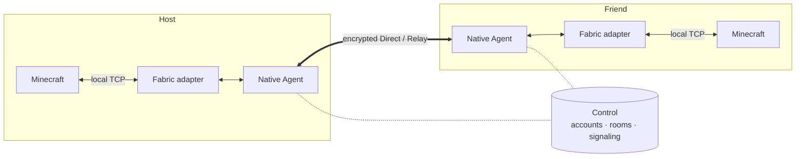

<div align="center">


# P2WLAN Minecraft

**Open a room in-game and play with friends as if you shared a LAN.**


[](LICENSE)

[简体中文](README.md) · English

[User guide (Chinese)](minecraft-mod/docs/quickstart.md) · [Technical reference](minecraft-mod/README.md) · [Documentation](docs/README.md) · [Contributing](CONTRIBUTING.md)

</div>

---

P2WLAN Minecraft is a **Fabric multiplayer Mod**. Sign in and create a room in-game; once friends join with the room code, the host's shared world appears in the vanilla Multiplayer list, ready to join with a double-click.

The Mod bundles a native Agent built on the encrypted networking core of [P2WLAN](https://github.com/yhan-sun/p2wlan). Players connect peer-to-peer whenever possible and fall back to an encrypted relay when hole punching fails. Everything runs in user space: no separate VPN client, no changes to system network interfaces or routes.

## Features

- **All in-game** — A pixel LAN icon in the title, Multiplayer and pause menus; `/p2wlan-client` opens the same panel.
- **Room-based play** — Create a room; friends join with an 8-digit room code and password.
- **Vanilla server browser** — Shared worlds appear in the Multiplayer list. Select, double-click or press Join Server; your saved servers stay untouched.
- **Integrated and dedicated servers** — Share or unshare a singleplayer world with one click; dedicated servers use `/p2wlan` commands to connect and publish.
- **Direct first, Relay fallback** — The native core handles encrypted sessions, NAT traversal and Direct/Relay switching.
- **Live network stats** — RTT, Direct/Relay path, virtual IP, jitter, MTU and traffic at a glance, plus an optional in-game HUD and latency statistics.
- **Vanilla flows preserved** — Minecraft login, authentication and resource-pack prompts work as usual; P2WLAN accounts are separate from Minecraft accounts.
- **Server account tool** — A standalone `p2wlan-account` CLI signs a dedicated server in and joins a room while the server is stopped, no GUI required.

## Requirements

| Component | Version |
| --- | --- |
| Minecraft | Java Edition **1.21.1** |
| Fabric Loader | **0.16.14** or newer |
| Fabric API | **0.116.7+1.21.1** |
| Java | **21** (64-bit, matching the Mod's native target) |
| P2WLAN Control | One Control service shared by all players — [self-hostable](docs/guides/self-hosting.md) |

Native targets: `macos-aarch64`, `macos-x86_64`, `linux-aarch64`, `linux-x86_64` and `windows-x86_64`. Each JAR contains the native program for its build host only; build once per platform.

## Quick start

```text
Sign in  →  Create / join room  →  Connect room  →  Host shares world  →  Friends join via Multiplayer
```

1. **Install** — Put Fabric API and the P2WLAN Mod JAR into `mods/` of a Fabric 1.21.1 instance ([build steps](#build-from-source)). With HMCL, import the HMCL ZIP through its modpack installer.
2. **Sign in** — Click the LAN icon, enter the Control root URL (e.g. `https://control.example.com`), then sign in or register a P2WLAN account.
3. **Join a room** — The host creates a room; friends enter its 8-digit code and password.
4. **Connect** — Every player clicks **连接 · room name** (Connect) in the room list to join the room network.
5. **Share** — The host opens a singleplayer world and clicks **共享本地世界** (Share local world) in the pause-menu P2WLAN panel.
6. **Play** — Friends open Multiplayer and pick the P2WLAN server.

When done, click **断开房间** (Disconnect room) in the panel. Leaving a world does not disconnect; after disconnecting, your session and room membership are kept.

### Dedicated server

1. While the server is stopped, use `p2wlan-account` to sign the server in and join a room.
2. Start the server normally and run these in the console (in-game they need permission level 4 and a leading `/`):

```text
p2wlan connect <room-code>   # connect the room
p2wlan runtime               # wait for "ready"
p2wlan host                  # publish the world
p2wlan world                 # check publication status
```

`p2wlan unhost` stops sharing; `p2wlan disconnect` leaves the room network.

See the **[user guide (Chinese)](minecraft-mod/docs/quickstart.md)** for full steps, HMCL import, display settings and troubleshooting.

## How it works



| Component | Role |
| --- | --- |
| **Fabric adapter** | Menus, room panel, world publication and Multiplayer list integration |
| **Native Agent** | P2WLAN networking core: encrypted sessions, Direct/Relay path selection, user-space TCP forwarding |
| **Control** | Accounts, rooms, device authorization and signaling; game traffic never passes through Control |

Room virtual IPs serve only the Mod's own game channel and are not exposed to other programs as a system interface.

## Build from source

Requires Python **3.11+**, a Rust toolchain with native build dependencies, and JDK **21**. The Gradle Wrapper is included; the first build downloads pinned dependencies.

From the root of a clean, committed, complete checkout:

```sh
# 1. Build and bundle the native program for this platform
python3 minecraft-mod/tools/native_bundle.py

# 2. Build the Fabric Mod
python3 minecraft-mod/tools/java.py fabric-build

# Optional: dedicated-server account tool
python3 minecraft-mod/tools/java.py account-build

# Optional: HMCL modpack (macOS Apple Silicon shown)
python3 minecraft-mod/tools/java.py hmcl-pack -PhmclPlatform=macos-aarch64
```

| Artifact | Path |
| --- | --- |
| Mod JAR | `minecraft-mod/java/adapters/fabric-1.21.1/build/libs/p2wlan-fabric-1.21.1-0.1.0.jar` |
| Account tool | `minecraft-mod/java/account-cli/build/distributions/p2wlan-account-0.1.0.zip` |
| HMCL modpack | `minecraft-mod/java/adapters/fabric-1.21.1/build/distributions/p2wlan-hmcl-fabric-1.21.1-<platform>-0.1.0.zip` |

Packaging verifies the embedded native program's source identity and hashes and aborts on mismatch; nothing executable is downloaded at runtime. Development packages, Windows cross-builds and test entry points are covered in the [technical reference](minecraft-mod/README.md).

## Status

**Experimental**, version `0.1.0`.

| | Scope |
| --- | --- |
| ✅ Verified | Local macOS (Apple Silicon): an actual Minecraft client joining a dedicated server through the Mod (offline-auth test server) |
| ⏳ Not yet done | Cross-machine/public-network play, full singleplayer-world sharing, Windows/HMCL on real devices, Linux graphical runs, online Minecraft authentication, forced Relay, long sessions and network-change recovery, compatibility with other Mods, independent security audit |
| ➖ Out of scope | Other Minecraft versions, Forge, NeoForge, Bedrock, mobile |

Direct connectivity depends on both sides' NAT and firewalls; without a configured Relay, players who cannot connect directly cannot play together.

## Security and privacy

- Prefer an **HTTPS** Control URL. HTTP works, but accounts, rooms and signaling travel in plain text, and the UI keeps warning about it.
- `config/p2wlan-private/` holds sessions and device identities — never share or commit it.
- A dedicated server keeps its existing listener; public exposure stays under the operator's control. Players arriving through the Mod appear from loopback, so IP-based bans or plugins need adjusting.

See the [privacy notice](PRIVACY.md); report vulnerabilities privately via the [security policy](SECURITY.md).

## Repository layout

```text
minecraft-mod/        The Mod
├── java/             Fabric adapter, common protocol, account tool, native resource packaging
├── native/           Rust workspace: Agent, TCP bridge, gateway, runtime adaptation
├── tools/            Build, packaging and verification scripts
├── tests/            Mod tests
└── docs/             Player documentation
client/               Upstream P2WLAN networking core and client (reused by the Mod)
server/  deploy/      Upstream Control/Relay services and deployment
docs/                 Upstream reference docs and shared engineering rules
```

## Credits and license

Networking comes from [P2WLAN](https://github.com/yhan-sun/p2wlan) — thanks to all upstream contributors.

Released under the [MIT License](LICENSE). Minecraft, Fabric, launchers and other dependencies are governed by their own licenses and terms.
