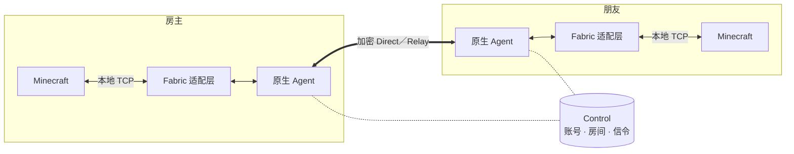

<div align="center">


# P2WLAN Minecraft

**在游戏里开房间，和朋友像在同一个局域网里一样联机。**


[](LICENSE)

简体中文 · [English](README.en.md)

[安装与联机指南](minecraft-mod/docs/quickstart.md) · [技术参考](minecraft-mod/README.md) · [文档导航](docs/README.md) · [贡献指南](CONTRIBUTING.md)

</div>

---

P2WLAN Minecraft 是一个 **Fabric 联机 Mod**。在游戏里登录、创建房间，朋友凭房间码加入后，房主共享的世界会直接出现在原版「多人游戏」列表中，双击即可进入。

Mod 内置原生 Agent，复用 [P2WLAN](https://github.com/yhan-sun/p2wlan) 的加密网络核心：玩家之间优先 P2P 直连，打洞失败时可经加密中继转发。整个通道运行在用户态，不需要另开 VPN 客户端，也不改动系统网卡和路由。

## 特性

- **游戏内一站式** — 标题、多人游戏和暂停菜单都有局域网像素图标，也可以用 `/p2wlan-client` 打开面板。
- **房间制联机** — 创建房间，朋友使用 8 位房间码和密码加入。
- **原版选服体验** — 房间内共享的世界出现在多人游戏列表里，选中、双击或「加入服务器」即可进入；已保存的服务器保持不变。
- **单人世界与专用服务器** — 单人世界一键共享／停止共享；专用服务器通过 `/p2wlan` 命令连接房间和发布世界。
- **直连优先，中继兜底** — 原生核心负责加密会话、NAT 打洞和 Direct／Relay 切换。
- **网络状态可视** — RTT、直连／中继、虚拟 IP、抖动、MTU 和累计流量一目了然，可选开启游戏内 HUD 和延迟统计。
- **原版流程不变** — 正版登录、认证和资源包确认保持原样；P2WLAN 账号与 Minecraft 账号相互独立。
- **专服账号工具** — 独立的 `p2wlan-account` 命令行工具，在服务器停机时完成登录和入房，无需图形界面。

## 环境要求

| 组件 | 版本 |
| --- | --- |
| Minecraft | Java Edition **1.21.1** |
| Fabric Loader | **0.16.14** 及以上 |
| Fabric API | **0.116.7+1.21.1** |
| Java | **21**（64 位，架构与 Mod 内原生程序一致） |
| P2WLAN Control | 一台所有玩家共用的 Control 服务，可[自行部署](docs/guides/self-hosting.md) |

原生程序支持 `macos-aarch64`、`macos-x86_64`、`linux-aarch64`、`linux-x86_64` 和 `windows-x86_64` 五个目标。每个 JAR 只包含构建主机所在平台的原生程序，不同平台需分别构建。

## 快速开始

```text
登录 P2WLAN  →  创建／加入房间  →  连接房间  →  房主共享世界  →  朋友在多人游戏中加入
```

1. **安装 Mod** — 在 Fabric 1.21.1 实例的 `mods/` 中放入 Fabric API 和 P2WLAN Mod JAR（[构建方法](#从源码构建)）。使用 HMCL 时，通过「整合包安装」导入 HMCL ZIP。
2. **登录** — 点击菜单里的局域网图标，填写 Control 根地址（如 `https://control.example.com`），登录或注册 P2WLAN 账号。
3. **进房间** — 房主创建房间；朋友输入 8 位房间码和密码加入。
4. **连接** — 每位玩家都在房间列表中点击「连接 · 房间名」，接入房间网络。
5. **共享世界** — 房主进入单人世界，在暂停菜单的 P2WLAN 面板中点击「共享本地世界」。
6. **加入游戏** — 朋友打开「多人游戏」，选择出现的 P2WLAN 服务器进入。

玩完后在面板中点击「断开房间」。退出世界不会自动断开；断开房间后，账号会话和房间成员关系依然保留。

### 专用服务器

1. 停服状态下，用 `p2wlan-account` 工具为服务器登录 P2WLAN 账号并加入房间。
2. 正常启动服务器，在控制台执行（在游戏内执行需要权限等级 4，并加上 `/` 前缀）：

```text
p2wlan connect <房间码>   # 连接房间
p2wlan runtime            # 等待显示 ready
p2wlan host               # 发布世界
p2wlan world              # 查看发布状态
```

`p2wlan unhost` 停止共享，`p2wlan disconnect` 断开房间。

完整步骤、HMCL 导入、显示设置和常见问题见 **[安装与联机指南](minecraft-mod/docs/quickstart.md)**。

## 工作原理



| 组件 | 职责 |
| --- | --- |
| **Fabric 适配层** | 游戏菜单、房间面板、世界发布和多人游戏列表集成 |
| **原生 Agent** | 复用 P2WLAN 网络核心：加密会话、直连／中继选路、用户态 TCP 转发 |
| **Control** | 账号、房间、设备授权与连接信令；游戏数据不经过 Control |

房间内的虚拟 IP 只服务于 Mod 自身的游戏通道，不会作为系统网卡暴露给其他程序。

## 从源码构建

需要 Python **3.11+**、Rust 工具链（含原生编译依赖）和 JDK **21**。Gradle Wrapper 已随仓库提供，首次构建会自动下载固定版本的依赖。

在干净且已提交的完整仓库根目录执行：

```sh
# 1. 构建并封装当前平台的原生程序
python3 minecraft-mod/tools/native_bundle.py

# 2. 构建 Fabric Mod
python3 minecraft-mod/tools/java.py fabric-build

# 可选：专服账号工具
python3 minecraft-mod/tools/java.py account-build

# 可选：HMCL 整合包（以 macOS Apple Silicon 为例）
python3 minecraft-mod/tools/java.py hmcl-pack -PhmclPlatform=macos-aarch64
```

| 产物 | 路径 |
| --- | --- |
| Mod JAR | `minecraft-mod/java/adapters/fabric-1.21.1/build/libs/p2wlan-fabric-1.21.1-0.1.0.jar` |
| 账号工具 | `minecraft-mod/java/account-cli/build/distributions/p2wlan-account-0.1.0.zip` |
| HMCL 整合包 | `minecraft-mod/java/adapters/fabric-1.21.1/build/distributions/p2wlan-hmcl-fabric-1.21.1-<平台>-0.1.0.zip` |

构建时会校验内嵌原生程序的源码身份与摘要，校验失败即中止；运行时也不会从网络下载可执行文件。开发包、Windows 交叉构建和测试入口见[技术参考](minecraft-mod/README.md)。

## 项目状态

项目处于**实验阶段**，当前版本 `0.1.0`。

| | 范围 |
| --- | --- |
| ✅ 已验证 | macOS（Apple Silicon）本机：真实 Minecraft 客户端经 Mod 加入专用服务器（离线认证测试服） |
| ⏳ 未完成 | 跨机器／公网联机、单人世界共享完整流程、Windows／HMCL 实机、Linux 图形环境、正版在线认证、强制中继、长时间游戏与切网恢复、与其他 Mod 的兼容性、独立安全审计 |
| ➖ 不在范围 | 其他 Minecraft 版本、Forge、NeoForge、基岩版、移动端 |

直连成功率取决于双方的 NAT 和防火墙环境；未配置 Relay 时，无法直连的玩家之间无法联机。

## 安全与隐私

- 尽量使用 **HTTPS** 的 Control 地址。HTTP 可用，但账号、房间和信令会以明文传输，界面会持续提示。
- `config/p2wlan-private/` 保存登录会话和设备身份，请勿分享或提交到版本库。
- 专用服务器原有的监听端口保持不变，公网暴露由管理员自行管理。经 Mod 进入的玩家在服务器看来来自本机回环地址，依赖真实 IP 的封禁或插件需要另行调整。

详见[隐私说明](PRIVACY.md)；安全问题请按[安全报告流程](SECURITY.md)私下提交。

## 仓库结构

```text
minecraft-mod/        Mod 本体
├── java/             Fabric 适配层、通用协议、账号工具、原生资源封装
├── native/           Rust workspace：Agent、TCP 桥、网关、运行时适配
├── tools/            构建、打包与校验脚本
├── tests/            Mod 测试
└── docs/             玩家文档
client/               上游 P2WLAN 网络核心与客户端（Mod 复用其网络实现）
server/  deploy/      上游 Control／Relay 服务与部署配置
docs/                 上游底层文档与共同工程规范
```

## 致谢与许可

网络实现来自 [P2WLAN](https://github.com/yhan-sun/p2wlan)，感谢上游全体贡献者。

本项目以 [MIT License](LICENSE) 发布。Minecraft、Fabric、各启动器及其他依赖遵循各自的许可与使用条款。
